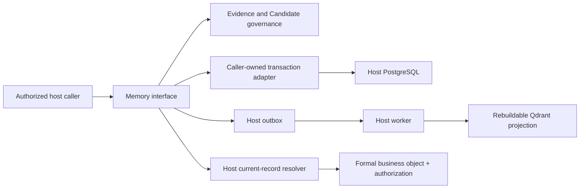

# Aletora

A lightweight Python module for **evidence, candidate governance, and authorized retrieval**.
Business knowledge stays in your application. Aletora does not create a second copy of published
rules or articles, run an agent, or decide who can access your records.

**V1 / experimental:** the interface is not a stable compatibility promise yet.

## What it does

- Preserves versioned sources, content hashes and citations.
- Separates source kind, epistemic kind and governance state.
- Records attributable review, application receipts, withdrawal and supersession.
- Enforces scoped idempotency and optimistic concurrency.
- Joins your PostgreSQL transaction through SQLAlchemy or Tortoise adapters.
- Treats Qdrant as a rebuildable projection, then re-reads and authorizes formal records.

**Accepted is not applied.** Your application's formal write, Aletora application receipt and
outbox append must share a transaction. A model's confidence or a search score cannot make a
candidate effective.

## Installation

Python 3.12 or newer. The base package has **no third-party runtime dependencies**.

```sh
# From this checkout; no public package release is implied.
python -m pip install .
python -m pip install '.[sqlalchemy,qdrant]'
# Or:
python -m pip install '.[tortoise]'
```

Optional adapters are imported explicitly from `aletora.adapters`; core imports do not load
ORMs, vector clients or model SDKs. No connections or collections are created automatically.

## Core lifecycle example

The in-memory adapter is for tests and demonstrations. In production, supply the appropriate
PostgreSQL transaction adapter and a durable host outbox sink instead.

```python
import asyncio
from datetime import datetime, timezone

from aletora import (
    EpistemicKind, GovernanceState, Memory, Proposal, Scope, SourceKind, SourceRef,
)
from aletora.adapters.memory import (
    InMemoryDatabase, InMemoryEventSink, InMemoryRecordStore,
)


async def example():
    database = InMemoryDatabase()
    memory = Memory(InMemoryRecordStore(database), InMemoryEventSink(database))
    # Illustrative identity only: the host must construct this after authorization.
    scope = Scope("tenant-1", "brand-1")
    now = datetime.now(timezone.utc)
    async with database.transaction():
        evidence = await memory.record_evidence(
            scope,
            SourceRef(SourceKind.DOCUMENT, "guide", "v1", "page:3"),
            "The guide recommends concise headlines.",
            idempotency_key="guide-v1-page3",
        )
        candidate = await memory.propose(
            scope,
            evidence.id,
            Proposal(
                "Prefer concise headlines.", EpistemicKind.ASSERTED,
                "extractor-actor", "extractor-v1", "run-1", now,
            ),
            idempotency_key="guide-v1-headline-proposal",
        )
        accepted = await memory.review(
            scope, candidate.id, GovernanceState.ACCEPTED,
            "independent-reviewer", "Checked against the source.",
            expected_revision=candidate.revision,
        )
        assert accepted.application is None  # No formal business object was created.


asyncio.run(example())
```

After writing a formal object in your own transaction, call `record_application` with its exact
`FormalRef` and expected candidate revision. Retrieval is explicitly configured with an index,
an embedding profile and a request-scoped host resolver; a missing capability raises an error.
`retrieve(..., limit=10)` returns authorized formal content and citations, never index text.
The result preserves epistemic kind, governance state, profile identity and a separate retrieval
score. Limits are 1–100; the default scan budget is 200 raw scanned index points. Denied or stale hits are skipped,
but exhausting that finite budget may return fewer results. A single context-managed index scan
prepares the query once and owns raw pagination; Memory stops consuming when enough authorized
results exist. Reads are checked during the caller's transaction; results are not a durable
authorization grant or a guarantee against later revocation.

## Ownership and architecture



A small interface concentrates lifecycle and retrieval checks in one deep module. Concrete
in-memory, SQLAlchemy and Tortoise adapters justify the persistence seam; callers and tests
exercise the same interface. See [the specification](docs/V1-SPEC.md) and
[ADR-0001](docs/adr/0001-host-owned-truth-and-transactions.md).

## Integration responsibilities

- Construct `Scope` only after authentication and object authorization; it is not a security token.
- Supply an already-open transaction and an outbox sink using that same transaction. SQLAlchemy AUTOCOMMIT connections are rejected before Aletora SQL. Roll back
  on any failed write, including an outbox failure; adapters do not commit, roll back or close it.
- Apply package SQL templates using your migration tooling. Validate shared RLS and dedicated
  schema provisioning for your deployment; do not assume an ORM adapter alone provides RLS.
- Authenticate reviewers and confirm formal object writes before recording application receipts.
- Supply a request-scoped resolver bound to the authenticated caller that reads **current,
  authorized** content for an exact formal object version. Tenant/namespace alone is not role
  authorization; do not reuse a privileged resolver for ordinary users.
- If independent products/databases share a Qdrant server, use separate collections or globally
  qualified Scope identities. Reusing local tenant/namespace names in the same collection does
  not provide cross-product isolation.
- Re-read current records in workers before updating/deleting projections; deduplicate event IDs.
- Treat external content as untrusted evidence, not instructions or executable actions.

Withdrawal prevents current recall but retains audit content. **Physical erasure, retention, PII
redaction, document parsing, graph reasoning and automated promotion are not implemented in V1.**
Hosts own these policies. Do not use the package as a sandbox against untrusted in-process code.

## Development and verification

See [development instructions](docs/DEVELOPMENT.md), [domain language](GLOSSARY.md),
[PostgreSQL integration](docs/POSTGRES.md) and [Qdrant integration](docs/QDRANT.md).
CI targets Python 3.12 and 3.14 with real PostgreSQL and local-mode Qdrant tests.
See [the validation record](docs/VALIDATION.md) for executed gates, review closure and limitations.
This repository does not claim verified integration with Impulsira or ServexaOS.

## License

Apache-2.0. The research informed an independent implementation; no upstream agent runtime
or source code was transplanted.
